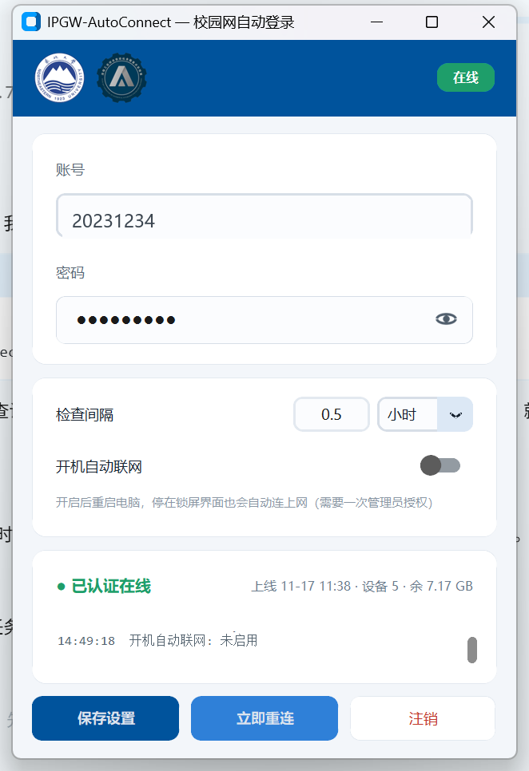

# IPGW-AutoConnect

IPGW-AutoConnect 是东北大学校园网的 Windows 自动登录工具，主要用于无人值守的实验室电脑和工作站。设备重启后即使停在 Windows 登录界面，程序也能在网络就绪后自动完成校园网认证。平时也可以挂在系统托盘里，定期检查掉线并尝试重连。

[下载 Windows 版 IPGW-AutoConnect.zip](https://github.com/sg1997k/IPGW-AutoConnect/releases/latest/download/IPGW-AutoConnect.zip)

## 首次使用

1. 下载并解压整个 ZIP 到固定目录，保留 `assets/` 与 `IPGW-AutoConnect.exe` 的相对位置。
2. 双击 `IPGW-AutoConnect.exe`，输入东北大学统一身份认证账号（学号或工号）和密码，点击「保存设置」。
3. 点击「立即重连」，确认界面显示已认证在线。
4. 用于无人值守时，打开「开机自动联网」并通过 Windows 管理员授权。平时只需要掉线重连时，运行托盘程序即可。

## 无人值守开机联网

「开机自动联网」会创建 Windows 计划任务。计算机启动时，任务以 `SYSTEM` 身份运行程序的无界面模式，在登录桌面前检查并恢复校园网认证。登录桌面后，程序可通过登录启动项缩小到系统托盘。

定时重启或断电恢复后自动开机需要在 Windows 或设备上另行配置。开机后仍需有线网络或 Wi-Fi 已接入，且设备能访问校园网认证服务。要用远程桌面、Tailscale、ToDesk 等工具连回电脑，还需要远程服务能在登录前启动，并且远程访问所需的网络路径可用。

启用后重启电脑并停留在登录界面，从另一台设备测试实际使用的远程连接。随后查看程序目录下的 `logs/auto.log`，确认有本次开机的运行和认证记录。开机阶段认证失败时，无界面模式会重试。若日志显示 `getaddrinfo failed`，检查开机阶段的网络接入和 DNS。若显示认证失败，先用学校统一身份认证网页核对账号状态和密码。

## 开着 VPN 时怎样判断是否掉线

程序先向东北大学校园网网关查询认证状态。网关超时、断开连接或返回无法识别的内容时，界面显示「待确认」，后台稍后复查，不提交账号密码。若通过当前系统网络路径访问华为的 HTTPS 连通性检测地址并收到预期的 204 响应，界面显示「网络可用」，随后按设定间隔检查。这个探测请求不携带校园网账号、密码或 Cookie。

只有网关明确回复当前连接未认证、且未检测到可用外网时，程序才会尝试自动认证。托盘和开机后台共用这套判断。真正掉线时会继续尝试恢复，连续失败时逐步延长间隔。

## 日常使用

- **自动重连**　按设定的分钟或小时间隔检查网络状态，检测到掉线后尝试重新认证。
- **手动操作**　在界面保存设置、立即重连或注销当前校园网会话。状态区显示认证状态、上线时间、在线设备数、剩余流量和运行日志。
- **系统托盘**　关闭窗口后程序会留在托盘。双击图标可重新打开设置，右键菜单可重连、刷新状态或退出托盘界面。

校园网认证请求直连学校认证服务，不使用系统代理。

账号和密码保存在程序目录的 `config.json` 中，密码为明文。分享程序时请使用原始下载包，避免分享含有个人配置的运行目录。

## 更新、迁移与卸载

更新前关闭「开机自动联网」，在托盘退出程序，再解压新版。需要保留配置时，可在本机备份并恢复 `config.json`。更新完成后重新启用开机联网并做一次重启验证。

计划任务记录了程序的绝对路径。移动程序前先关闭「开机自动联网」，到新位置运行后再启用。卸载时，关闭「开机自动联网」以移除计划任务和登录启动项，从托盘退出后删除程序目录。

## 从源码运行

在 Windows 上使用 Python 3.10 或以上版本，执行 `python -m pip install -r requirements.txt` 后运行 `python app.py`。也可以双击 `启动.bat`。安装 PyInstaller 6 后，运行 `python -m PyInstaller IPGW-AutoConnect.spec` 即可生成 Windows 可执行文件。

## 许可与致谢

代码采用 [MIT 许可证](LICENSE)。认证实现参考 [Neboer/ipgw-py-manager](https://github.com/Neboer/ipgw-py-manager)，使用[东北大学校园网认证服务](https://ipgw.neu.edu.cn/)。界面与打包使用 CustomTkinter、pystray、Pillow 和 PyInstaller。

供本校师生使用，请遵守学校网络使用规定。校徽和实验室标志按学校对标识素材的规定使用。
